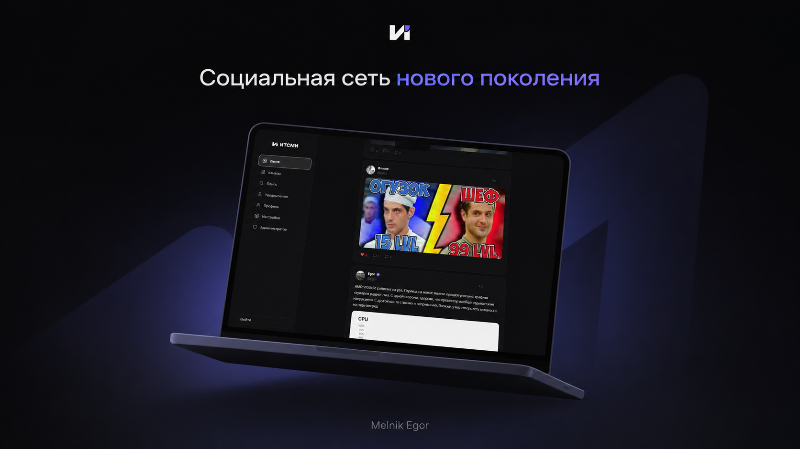

  
    

  
<strong>Русскоязычная социальная сеть нового поколения</strong>

  

    
    
    
  

---

  

---

## О проекте

**ИТСМИ** — полноценная русскоязычная социальная сеть с лентой, каналами, подписками и уведомлениями в реальном времени. Написана с нуля командой **Aethel Dev**.

Проект работает на [итсми.site](https://итсми.site) и обслуживает реальных пользователей.

---

## Возможности

### Пользователи
- Регистрация и авторизация
- Профиль с аватаром, именем, биографией и онлайн-статусом
- Верификация аккаунта (синий зубчатый щит)
- Подписки и лента подписок

### Контент
- Публикация постов с изображениями
- Лайки, репосты, комментарии
- @упоминания с автоматическими уведомлениями
- Редактирование и удаление своих постов
- Закладки

### Каналы
- Создание тематических каналов
- Подписка на каналы
- Верифицированные каналы

### Коммуникация
- Уведомления в реальном времени (WebSocket): лайки, комментарии, подписки, упоминания
- Обновления ленты без перезагрузки страницы

### Поиск
- Полнотекстовый поиск по постам и пользователям

### Интерфейс
- Тёмная и светлая тема
- Адаптивный дизайн для десктопа и мобильных устройств
- Свайп-навигация на мобиле
- Glassmorphism навбар

---

## Стек

| Слой | Технологии |
|------|-----------|
| **Backend** | Node.js, Express, PostgreSQL |
| **Auth** | JWT, bcryptjs |
| **Real-time** | WebSocket |
| **Медиа** | Multer, Sharp |
| **Безопасность** | Helmet, express-rate-limit, XSS-фильтрация |
| **Frontend** | Vanilla JS, CSS Variables |
| **Деплой** | PM2, Caddy, Ubuntu 24.04 |

---

## Скриншоты

> Скоро

---

## Авторы

<table>
  <tr>
    <td align="center">
      <strong>Melnik Egor</strong> 
      Founder & Lead Developer 
      Aethel Dev
    </td>
  </tr>
</table>

---

## Участие в разработке

Хочешь предложить идею или сообщить о баге? Читай [CONTRIBUTING.md](CONTRIBUTING.md).

---

## Лицензия

© 2025–2026 Melnik Egor, Aethel Dev. Все права защищены.  
Копирование, распространение и использование кода без письменного разрешения автора запрещено.
